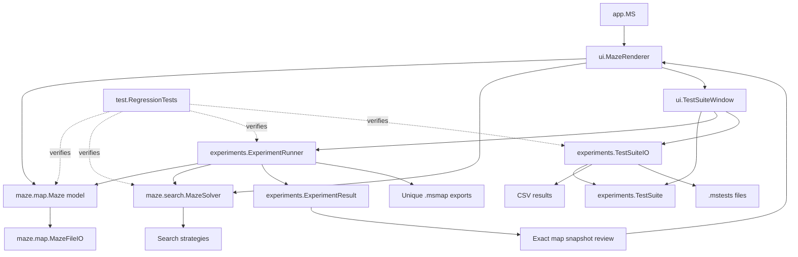

# Maze-Solver Current Plan and Feature Checklist

This document is the current implementation reference for the SOFE 3720
Option 1 Intelligent Route-Planning Agent. It describes the implemented
features, current package architecture, validation commands, and follow-up
work. The `doc/html` reference is generated for release 0.7 from the package-aware
Java source Javadocs and Markdown documentation.

## Table of Contents

- [Current Status](#current-status)
- [Implemented Feature Checklist](#implemented-feature-checklist)
- [Architecture](#architecture)
- [Map Format](#map-format)
- [Experiment Workflow](#experiment-workflow)
- [Search Behavior](#search-behavior)
- [Source Responsibilities](#source-responsibilities)
- [Validation](#validation)
- [Refactor Roadmap](#refactor-roadmap)
- [Remaining Work](#remaining-work)

## Current Status

The application implements the core weighted route-planning agent and the
repeatable experiment workflow:

- Weighted four-directional maze graphs.
- DFS, BFS, Uniform Cost Search, Greedy Best-First Search, and weighted A*.
- Interactive animated solving and instant solving.
- Seeded map generation with configurable obstacles, costs, endpoints, and
  reachability.
- Test-suite persistence using human-readable `.mstests` files.
- Human-readable individual maps using `.msmap` files.
- Embedded saved maps so a suite does not depend on the original map file.
- Reproducible multi-algorithm comparisons.
- JVM warm-up before measured experiment runs.
- CSV metrics export.
- Unique map export with iteration grouping.
- Exact per-result map snapshots and animated result review.
- Dependency-free regression coverage.
- Release metadata centralized in `app.Version` at 0.7.
- `.mstests` files record the application release separately from their stable
  schema version.

## Implemented Feature Checklist

### Interactive application

- [x] Title screen with import, random generation, and test-suite entry points.
- [x] Import and save dialogs start in the application directory.
- [x] Map import/save dialogs accept `.msmap`.
- [x] Animated timer solving with start, pause, restart, and configurable delay.
- [x] Instant solving in a background worker.
- [x] Runtime algorithm selection.
- [x] Load, save, and generate map actions during a solve session.
- [x] Zoom buttons and Ctrl+mouse-wheel zoom.
- [x] Viewport clipping for large maps.
- [x] Grid and start/goal rendering.
- [x] Visited-node and final-path rendering.
- [x] Directional movement-cost overlay.
- [x] Result review windows that do not close the whole application.

### Weighted map model

- [x] Four cardinal directions in fixed `[NORTH, EAST, SOUTH, WEST]` order.
- [x] Positive movement costs from `1` through `100`.
- [x] Cost `0` for blocked, missing, or disabled movement.
- [x] Asymmetric reverse-direction costs.
- [x] Validation that weights match map topology.
- [x] Legacy layout-only maps with implicit cost `1`.
- [x] Text export through `Maze.exportToText()` and `.msmap` file export.
- [x] Text import through `Maze.importFromText(...)` and file import.

### Search algorithms

- [x] DFS baseline.
- [x] BFS baseline.
- [x] UCS ordered by accumulated cost `g(n)`.
- [x] Greedy Best-First Search ordered by Manhattan distance `h(n)`.
- [x] A* ordered by `g(n) + h(n)`.
- [x] Disabled-edge handling in every algorithm.
- [x] Route reconstruction.
- [x] Path length, path cost, visited count, and solver-only runtime metrics.
- [x] Positive-cost Manhattan heuristic guarantees for UCS and A*.

### Test suites

- [x] Suite and row validation.
- [x] Automatic, manual, and saved-map sources.
- [x] Fixed, random, and approximate-distance endpoints.
- [x] Natural, guaranteed-solvable, and guaranteed-unsolvable reachability.
- [x] Uniform and random cost generation.
- [x] Configurable dimensions and interior blocked percentage.
- [x] Shared map instance across selected algorithms per iteration.
- [x] Deterministic iteration seed derivation.
- [x] Saved-map reuse without generated seeds.
- [x] Cancellation and progress reporting.
- [x] Three-round JVM warm-up excluded from measured results.
- [x] Results table with map source, seed/file label, metrics, and Review action.
- [x] `.mstests` save/load with embedded Base64 map text.
- [x] Strict suite extension validation.

### Exports

- [x] UTF-8 CSV results export.
- [x] Unique map export for every suite row.
- [x] Repeated map iterations grouped in filenames.
- [x] Export folder named `<suite-name>-maps`.
- [x] Exported maps use `.msmap`.
- [x] Windows-invalid filename characters sanitized.

## Architecture



### Runtime boundaries

- `maze.map.Maze` owns graph topology, occupancy, endpoints, costs, and generation.
- `maze.map.MazeFileIO` owns `.msmap` parsing and serialization.
- `maze.search.MazeSolver` remains the public incremental search facade and metrics owner;
  focused strategy classes own algorithm-specific frontier behavior.
- `MazeRenderer` owns Swing controls, painting, animation, and interactive
  solve orchestration.
- `TestSuite` owns validated experiment configuration.
- `ExperimentRunner` owns non-Swing map generation and algorithm execution.
- `ExperimentResult` is an immutable record of one algorithm/map run,
  including the exact serialized map text.
- `TestSuiteIO` owns suite persistence and CSV formatting.
- `TestSuiteWindow` coordinates the experiment window; table models, editors,
  renderers, and panels own focused Swing responsibilities.

## Map Format

Map files are UTF-8 human-readable `.msmap` files. The required header is:

```text
<row count>
<column count>
start: <row>,<column>
end: <row>,<column>
<one 0/1 layout row per maze row>
```

An optional `WEIGHTS` section follows the layout:

```text
WEIGHTS
<north>,<east>,<south>,<west>
```

There is one weight row for every coordinate, including blocked cells, in
row-major order. Blocked cells and invalid directions use `0`. Enabled costs
must be in the inclusive range `1..100`. The importer validates dimensions,
layout values, endpoints, weight count, ranges, and topology.

Layout-only legacy files remain readable. Their adjacent open cells receive
cost `1`. New exports always include the complete weighted representation.

## Experiment Workflow

1. Open **Configure Tests** from the title screen.
2. Add one row per experimental condition.
3. Select a map source:
   - **Automatic seed**: a seed is assigned when the suite is saved.
   - **Manual seed**: use the entered seed for deterministic generation.
   - **Saved map**: import an `.msmap`; its contents are embedded in the suite.
4. Select algorithms and iteration count.
5. Save the suite as `.mstests` when persistence is needed.
6. Run tests.
7. Use **Review** beside a result to reopen its exact map in the animated
   renderer.
8. Use **Export Maps** to choose a parent directory. The application creates
   `<suite-name>-maps` and exports only unique maps, grouping repeated
   iterations in filenames.
9. Use **Export CSV** for detailed metrics.

Generated maps are created once per row/iteration and shared by every selected
algorithm. Saved maps are reused for every iteration. Warm-up executions are
not included in results, progress, CSV output, or runtime measurements.

## Search Behavior

| Algorithm | Priority | Guarantee |
|---|---|---|
| DFS | Most recently discovered node | No shortest-path guarantee |
| BFS | Fewest edges | Shortest route only when enabled costs are equal |
| UCS | `g(n)` | Minimum-cost route with positive costs |
| Greedy | `h(n)` | Fast heuristic guidance; not minimum-cost guaranteed |
| A* | `g(n) + h(n)` | Minimum-cost route with positive costs |

The Manhattan heuristic is admissible and consistent because each enabled move
costs at least `1` and every move changes Manhattan distance by at most `1`.

## Source Responsibilities

| File | Responsibility |
|---|---|
| `src/app/MS.java` | Application entry point |
| `src/maze/map/Maze.java` | Maze graph, costs, generation, and validation |
| `src/maze/map/MazeFileIO.java` | `.msmap` parsing and serialization boundary |
| `src/maze/search/MazeSolver.java` | Incremental search facade and metrics |
| `src/maze/search/UninformedSearch.java`, `UCS.java`, `GreedySearch.java`, `Astar.java` | Focused search strategies; `UninformedSearch` handles both DFS and BFS |
| `src/ui/MazeRenderer.java` | Swing UI, rendering, animation, and map controls |
| `src/experiments/TestSuite.java` | Suite/test-row models and validation |
| `src/experiments/ExperimentRunner.java` | Warm-up, seeded execution, results, map export |
| `src/experiments/ExperimentResult.java` | Immutable run metrics and map snapshot |
| `src/experiments/TestSuiteIO.java` | `.mstests` persistence and CSV export |
| `src/ui/TestSuiteWindow.java` | Window coordination and experiment actions |
| `src/ui/*TableModel.java` | Configuration and result table state |
| `src/ui/*Editor.java` / `*Renderer.java` | Reusable experiment table controls |
| `test/java/RegressionTests.java` | Dependency-free automated regression checks |

## Validation

From the repository root:

```powershell
New-Item -ItemType Directory -Force build\classes | Out-Null
$sources = @(
    (Get-ChildItem -Filter *.java src -Recurse).FullName
    (Get-ChildItem -Filter *.java test\java -Recurse).FullName
)
javac -Xlint:all -d build\classes $sources
java -cp build\classes test.RegressionTests
git diff --check
```

The regression suite covers weighted round trips, all algorithms, seeded
reproducibility, suite persistence, CSV output, embedded saved maps,
cancellation, and unique map export.

JavaDoc can be checked without generating the Doxygen/PDF artifacts:

```powershell
$files = (Get-ChildItem src -Filter *.java).FullName
javadoc -quiet -Xdoclint:all -d "$env:TEMP\maze-javadoc" $files
```

## Refactor Roadmap

This refactor reduces the size and coupling of the three largest classes while
preserving their existing public behavior. Each phase is independently
validated before the next boundary is changed.

### Phase 1: Map persistence boundary

- [x] Add `maze.map.MazeFileIO` for `.msmap` file/text parsing and serialization.
- [x] Keep `Maze.importFromFile`, `Maze.importFromText`, `exportToFile`, and
  `exportToText` as compatibility delegates.
- [x] Preserve legacy layout-only files, `WEIGHTS` validation, directional
  `[N,E,S,W]` costs, extension checks, and existing error behavior.
- [x] Add round-trip and invalid-input regression coverage through the public
  compatibility methods.

### Phase 2: Search strategy boundary

- [x] Add a package-private strategy abstraction for initialization and
  one-node incremental steps.
- [x] Extract DFS/BFS frontier behavior into focused strategy classes.
- [x] Extract UCS and Greedy Best-First frontier behavior, including stale and
  closed-entry handling.
- [x] Extract weighted A* frontier behavior and priority entries.
- [x] Keep `MazeSolver` responsible for algorithm selection, lifecycle,
  metrics, parent-chain reconstruction, and the existing public API.
- [x] Confirm identical path, cost, visited-count, completion, and incremental
  update behavior with regression tests.

### Phase 3: Experiment UI boundary

- [x] Extract configuration and result table models from `TestSuiteWindow`.
- [x] Extract context-sensitive configuration table editability and rendering.
- [x] Extract reusable cell editors/renderers, including algorithm and saved-map
  controls.
- [x] Extract configuration/results panels while keeping window-level actions
  and worker lifecycle centralized.
- [x] Preserve endpoint/map-source enablement, review buttons, CSV export, map
  export, suite persistence, and cancellation behavior.

### Implementation order

1. Phase 1 established the map I/O boundary shared by experiment and review
   workflows.
2. Phase 2 established the search-strategy boundary while preserving
   `updateSolve()`.
3. Phase 3 completed the UI extraction after the domain and solver boundaries
   were stable.
4. Future refactors should compile with `javac -Xlint:all`, run
   `test.RegressionTests`, run JavaDoc validation, and run `git diff --check`.

## Remaining Work

- Add richer statistical analysis across repeated runs if required by the
  course report.
- Add optional benchmark charts or a separate analysis export.
- Decide whether to add a dedicated application-level logging toggle in place
  of verbose diagnostic console output.
- Regenerate the release documentation after public API or package
  documentation changes by running `doxygen Doxyfile` from `doc`; build the
  release PDF with the XeLaTeX commands documented in `README.md`.
- Add richer user-facing validation explanations for every disabled saved-map
  configuration field if usability testing identifies confusion.

These are follow-up improvements, not blockers for the current weighted
route-planning agent implementation.
